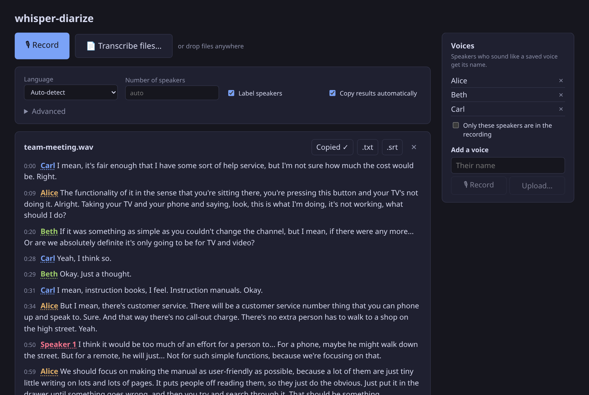
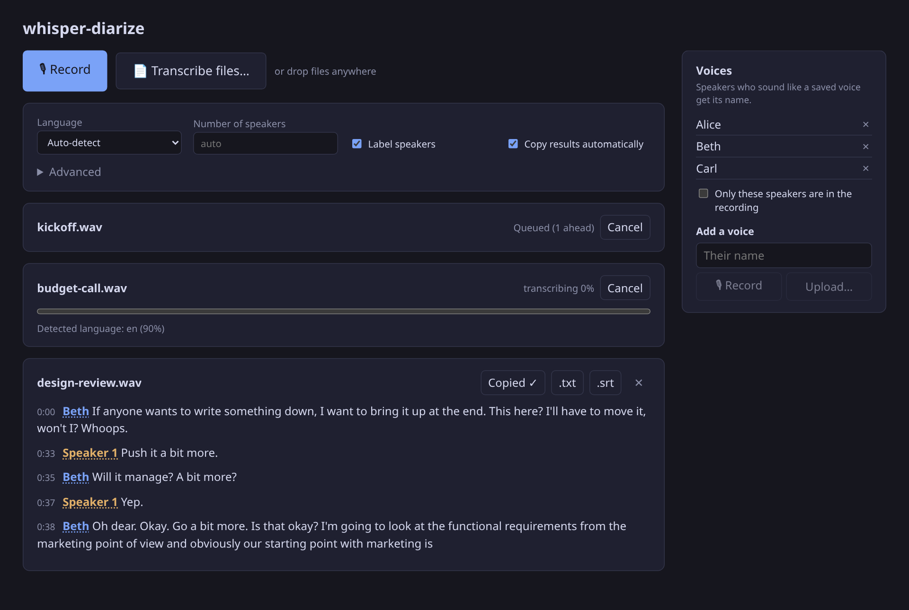
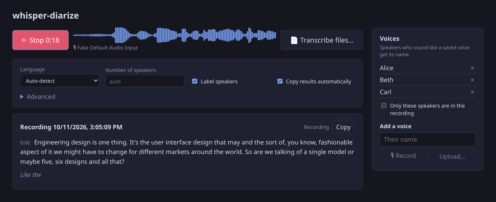

# whisper-diarize

Transcription with speaker labels, on your own GPU. Upload files (as many as you like: they
queue up) or record from the browser with a live transcript while you talk, or batch-convert
files from the command line.



<p>
  
  
</p>

<sub>Screenshots use audio from the <a href="https://groups.inf.ed.ac.uk/ami/corpus/">AMI Meeting
Corpus</a> (CC BY 4.0). Alice, Beth and Carl are names given to its speakers in the voice bank.</sub>

- **Transcription:** [faster-whisper](https://github.com/SYSTRAN/faster-whisper) (large-v3 by default).
  Every whisper option is exposed under *Advanced → All settings* / `--set`.
- **Diarization:** [pyannote community-1](https://huggingface.co/pyannote/speaker-diarization-community-1),
  using its "exclusive" output (one speaker at a time). Each word gets the speaker it overlaps
  most, then each sentence gets its majority speaker.
- **Voice bank:** save people's voices once (record them, upload a clip, or click a speaker in a
  transcript) and they're named automatically from then on. See [Voices](#voices).
- **No audio or transcripts are stored.** Audio is decoded in memory and dropped once processed.
  Transcripts live in memory until the browser collects them (or 15 min). The browser keeps your
  settings; the server keeps only the voice bank (names + voiceprints).
- **Shares the GPU politely.** Jobs run one at a time, and users take turns in the queue. Before
  loading a model, a job waits until enough VRAM is free. On CUDA OOM it backs off and retries
  with smaller batches. If the GPU stays busy, it falls back to CPU. Models are unloaded after 30
  idle seconds; reloading takes ~1.5 s. An idle server keeps only its ~260 MB CUDA context.
  There's no preemption: if another program grabs the GPU mid-job, whichever process next
  allocates past the limit gets the OOM. Jobs are short (30 min of audio ≈ 30 s), so the window
  is small.

Originally based on [whisper-diarization](https://github.com/MahmoudAshraf97/whisper-diarization).

## Setup

Needs [uv](https://docs.astral.sh/uv/), [bun](https://bun.sh) and an NVIDIA GPU with a CUDA 12
capable driver. It also runs on CPU, just slower.

```sh
git clone https://github.com/joy-void-joy/whisper-diarize && cd whisper-diarize
uv sync
# Diarization model is gated: accept the terms on
# https://huggingface.co/pyannote/speaker-diarization-community-1 then
uvx hf auth login
```

## Use

```sh
bun start                                    # web UI + API on http://127.0.0.1:5801
bun dev                                      # same, but rebuilds/restarts on every code change

uv run whisper-diarize transcribe a.m4a b.mp4 --language fr -f txt -f srt
uv run whisper-diarize transcribe --files-from toconvert --out-dir transcripts
uv run whisper-diarize transcribe talk.opus --num-speakers 2 --set beam_size=1 --set 'temperature=[0, 0.4]'
uv run whisper-diarize options               # every option with its default
```

The CLI skips files whose outputs already exist (`--overwrite` to redo), so an interrupted batch
can simply be restarted.

Server settings are environment variables (see `src/whisper_diarize/config.py`), e.g.
`WD_PORT=5801`, `WD_IDLE_UNLOAD_S=30`, `WD_GPU_WAIT_S=300`, `WD_CPU_FALLBACK=false`.

### Voices

Every job compares each detected speaker with the saved voices. A speaker who matches one closely
enough (`voice_threshold`, 0.5 by default) is shown under that name. Everyone else stays
"Speaker N", and saved voices that aren't in the recording are simply ignored.

- **Untick a voice** in the sidebar (`--absent NAME` in the CLI) when that person isn't in the
  recording, so their name is never used. Everything else stays automatic.
- **"Only the ticked speakers are in the recording"** (`--speaker NAME`, repeated for each) splits
  the recording into exactly that many speakers and gives each one of those names. That only
  works if each of them really speaks: otherwise someone else gets the missing person's name.
- **Click a speaker's name** in a transcript to name them everywhere and save their voice, or
  choose "Just this part" to fix who said particular sentences.

```sh
uv run whisper-diarize voices add Alice alice-hello.m4a   # 10-30 s of them talking, mostly alone
uv run whisper-diarize voices list
uv run whisper-diarize transcribe call.m4a --speaker Alice --speaker Bob
uv run whisper-diarize transcribe meeting.m4a --absent Carol
```

Adding another sample to an existing name averages them, which helps when recordings come from
different microphones. The bank is `~/.local/share/whisper-diarize/voices.json`
(`WD_VOICES_PATH`), shared by everyone using the server and by the CLI. It holds names and
voiceprints (pyannote speaker embeddings), never audio.

Tested on AMI meetings, enrolling each of 4 people from ~30 s of one meeting and transcribing
another meeting with the same people:

- All 4 were named, with 97% of talk time under the right name. The rest are sentences at speaker
  changes landing on the wrong side.
- A meeting of 4 strangers got no names.
- With only 2 of the 4 saved, those 2 were named (98% correct) and the other 2 stayed "Speaker N".

### VRAM

Measured on an RTX 3090 with large-v3 in float16, for 30 minutes of audio:

| batch_size | peak VRAM | time |
|---|---|---|
| 1 | 4.3 GB | 47 s |
| 8 (default) | 6.1 GB | 28 s |
| 16 | 8.2 GB | 25 s |

Diarization adds ~1.1 GB on top (pyannote's embedding batch is set to 4: its default of 32
peaks at 11.8 GB for no speed gain). A full run on a 14-minute meeting takes 27 s and peaks at
6.3 GB.

On CPU (Ryzen 9 5950X, int8), large-v3 runs at about 0.4× realtime and large-v3-turbo at about 0.25×.

### Diarization: pyannote vs the old NeMo MSDD

Diarization error rate (lower is better, 0.5 s collar, overlap excluded) against human labels
from the AMI meeting test set (4 speakers per meeting):

| | 3 full meetings (14–25 min) | 12 × 20 s excerpts | 12 × 60 s excerpts |
|---|---|---|---|
| NeMo MSDD (old) | 28.2% | 31.3% | 34.3% |
| pyannote community-1 | **8.7%** | **17.3%** | **16.7%** |

The old pipeline found only 2 of 4 speakers in one meeting. pyannote did worse on one 23 s,
3-voice podcast clip, where it heard a single speaker. Setting `num_speakers` (or `min_speakers`)
fixes that. Caveat: pyannote was trained on data that includes AMI (other meetings), while the
NeMo model used here is tuned for phone calls.

## Deploying behind Caddy

The app trusts the proxy for authentication. It reads the user name from `X-Remote-User`, and
each user only sees their own jobs. Keep it on 127.0.0.1 (the default) and reach it from the
Caddy machine through an SSH reverse tunnel:

```sh
bun start                                     # listens on 127.0.0.1:5801
ssh -N -R 5801:127.0.0.1:5801 your-server     # or a RemoteForward line for autossh
```

```caddy
whisper.example.com {
	basic_auth {
		# caddy hash-password --plaintext "$(xkcdpass)"   (one line per person, so access can be revoked individually)
		me     $2a$14$...
		friend $2a$14$...
	}
	reverse_proxy 127.0.0.1:5801 {
		header_up X-Remote-User {http.auth.user.id}
	}
}
```

To restart (e.g. after an update) without cutting anyone off, wait until nothing is in progress:

```sh
uv run whisper-diarize status          # "idle" or e.g. "busy: 1 transcribing, 2 queued"
uv run whisper-diarize status --wait   # returns once idle; then restart
```

Pages that are merely open don't count: they hold nothing on the server and keep working after
a restart. Only work in progress (queued or running jobs, uploads, live recordings) would be lost.

One server handles both the UI and `/api`, so no separate route is needed. There are no
WebSockets or long-lived streams, Caddy sets no upload size limit by default, and its HTTPS
satisfies the browser's requirement for microphone access. URLs in the app are relative, so it
also works under a sub-path (`handle_path /whisper/* { reverse_proxy ... }`).

Two things to check on the Caddy machine:
- **The forwarded port must be on loopback only.** `ss -ltn | grep 5801` there should show
  `127.0.0.1:5801`. With `GatewayPorts yes` in sshd_config it binds to all interfaces, and anyone
  could reach the app directly, skipping the login.
- **Other users or services on that machine can reach it too.** If anything else runs there, set
  `WD_PROXY_SECRET` (generate it once with `openssl rand -hex 32`) and add
  `header_up X-Proxy-Secret "<secret>"` to the `reverse_proxy` block. Requests without it get a 403.

Live recording sends audio over plain HTTP requests rather than a WebSocket, because Safari
doesn't send Basic credentials on WebSocket connections.

## Development

`bun dev` (= `uv run whisper-diarize serve --dev`) rebuilds the UI on every change (refresh
the page) and restarts the server when Python code changes. Jobs in progress are lost on restart,
so use `bun start` for an instance other people rely on.
For hot module reloading while working on the UI, also run `cd frontend && bun run dev`. It
serves on Vite's port and proxies `/api` to :5801.

```sh
uv run pytest
```
